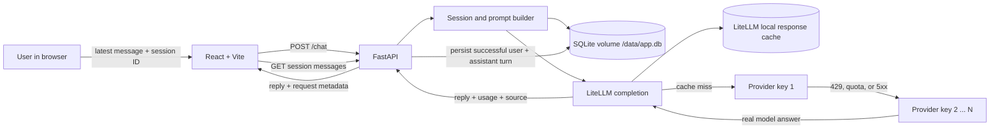

# Lyftr AI architecture

The Vite application keeps a client generated session ID and sends just the latest user message. FastAPI rebuilds the prompt from the system instruction and SQLite history, then calls LiteLLM. LiteLLM's in-process local cache keys the complete model request. If the cache misses, the backend tries configured credentials in order. Successful turns and their per-request metadata are written in one SQLite transaction.

## Request and persistence flow

1. The browser creates a fresh session ID on each page load and posts the newest message only.
2. FastAPI validates input and loads prior user and assistant messages. It uses the session's stored system prompt, the supplied override, or the configured default.
3. LiteLLM performs an exact request cache lookup. Cache identity includes model and all messages, including the system prompt and complete conversation history. The session ID is never sent to LiteLLM.
4. On a miss, credentials are tried in order. Retryable rate limit, quota, and server errors advance to the next key. The simulation header skips configured keys for this request only and disables cache for that request.
5. Only after a real or cached completion succeeds, the backend writes both messages and the assistant metadata to SQLite atomically.

## Runtime pieces

- `frontend/src/App.jsx` owns the chat list, active session, loading state, and API requests.
- `backend/app/main.py` exposes health, chat, and session-history endpoints.
- `backend/app/services/llm_service.py` owns LiteLLM cache setup, key iteration, provider error handling, and token/latency extraction.
- `backend/app/database.py` creates the schema and encapsulates history and turn persistence.
- `docker-compose.yml` connects the browser-served frontend and API, and mounts the named persistent data volume.

The application uses SQLite and process-local LiteLLM caching as required. A single backend instance is the intended deployment shape for those local resources.
