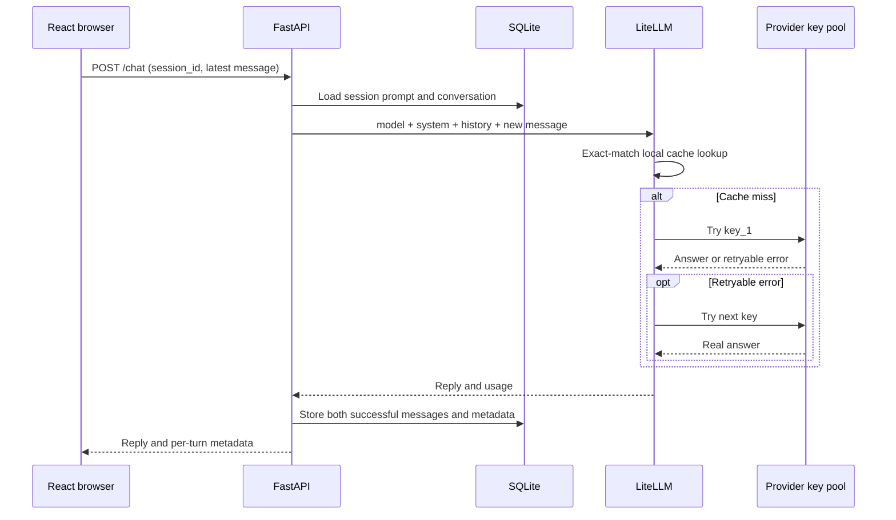

# Interview guide

## Architecture

Lyftr AI is a React + Vite single-page chat UI backed by a FastAPI service. The browser owns the active session ID and sends only each new message. FastAPI loads the session's existing conversation from SQLite, prepends its system prompt, and asks LiteLLM for one completion. It stores the user and assistant messages only after success. The assistant row contains that request's source, model, latency, token usage, key identifier, and fallback count.

## Important modules

- `frontend/src/App.jsx`: creates a session per page load, selects conversations, sends the latest message, shows readable errors, and renders the metadata beside each assistant answer.
- `backend/app/main.py`: wires FastAPI, CORS, startup, JSON errors, and the three public routes.
- `backend/app/config.py`: reads model, comma-separated keys, SQLite URL, CORS origins, default prompt, and simulation switch from environment variables.
- `backend/app/database.py`: initializes the `messages` and `sessions` tables, loads chronological messages, and commits successful turns together.
- `backend/app/services/llm_service.py`: enables LiteLLM's built-in local cache; sends the full message list; tries credentials as `key_1`, `key_2`, etc.; classifies retryable errors; and reads the provider's token usage.
- `backend/tests`: uses deterministic fake provider responses to check API behavior without publishing or requiring secrets.

## Frontend-to-backend request

Each new page load creates an ID with `crypto.randomUUID()`. The frontend sends `{session_id, message}` and optionally `system_prompt`; it never sends accumulated history. After success, the reply stays paired with the metadata returned for that exact request. The history endpoint can rebuild a selected session from SQLite and never returns the hidden system instruction.

## FastAPI and validation

Pydantic validates session IDs and trimmed message lengths. FastAPI returns 422 for invalid JSON or fields. The route constructs messages in the order system, old conversation, new user message. Persistence happens only after LiteLLM succeeds, which prevents failed requests from appearing as successful chat history. Unknown history IDs return 404.

## LiteLLM, key fallback, and caching

The service calls LiteLLM's Python completion interface with a configured model and one API key per attempt. Keys are assumed to be for the same provider/model configuration; users should not mix provider credentials with a model that cannot use them. Rate limit, quota, and HTTP 5xx errors move to the next key. If all attempts fail, the client receives a clean 503 without provider details.

LiteLLM's `local` cache is process-local and exact-match. Since the full model request includes the system prompt and all previous turns, different contexts do not collide, while identical first turns across separate session IDs can reuse a cached response. LiteLLM cache metadata identifies a hit; the response then reports `LLM_CACHE`, keeps its cached token usage, sets `key_id` to null, and sets fallback attempts to zero. Failure simulations bypass cache so they actually exercise fallback.

## SQLite and session management

`messages` holds user and assistant content, JSON assistant metadata, and ISO timestamps. `sessions` stores the session's system prompt privately. The session ID isolates the histories. A single transaction stores each successful two-message turn. Docker Compose mounts `lyftr-data` at `/data`, so the database survives container replacement.

## Token and latency tracking

Input and output counts come from the LiteLLM completion usage fields and describe that individual completion. They are not added to session totals. Server-side `perf_counter` timing yields an integer duration around the completion request, including local cache lookup.

## Docker layout

Compose builds a small multi-stage Python image and a multi-stage Node-to-Nginx frontend image. The API listens on port 8000; the static frontend listens on port 3000. The frontend API URL is embedded at Vite build time and is set to `http://localhost:8000` for local Compose. Render's blueprint mounts persistent storage at `/data`; Vercel serves the Vite `dist` directory.

## Interview questions and answers

**Why does the frontend send only one message per request?** The backend remains the source of truth for context. This avoids trusting a client to provide or alter prior conversation history and makes session persistence consistent.

**Why cache the full conversation rather than just the latest question?** An answer can change when earlier context or the system prompt changes. Including every message prevents using an answer generated for a different context.

**How does key failover work?** The service maps key positions to stable IDs, calls the configured model with each key, and advances only for rate limiting, quota exhaustion, or server errors. It returns a generic 503 after exhausting the pool.

**Why is there no database write before inference?** A provider failure should not create a partial turn that looks like a completed user interaction. Both the user's message and assistant's response are committed only after a successful response.

**What is the cache limitation?** The required in-process local cache is scoped to one backend process. Multiple replicas do not share cache entries, so deployment should stay single instance unless the assignment allows a shared cache service.

**How are tokens measured?** The backend returns LiteLLM's prompt and completion usage for the individual call; cached responses keep their original usage.

**How can failover be demonstrated without burning real keys?** Set `ENABLE_FAILURE_SIMULATION=true` and send `X-Simulate-Failure: key_1=429`. The first key is skipped for that request, and the next configured key must produce a genuine model answer.
